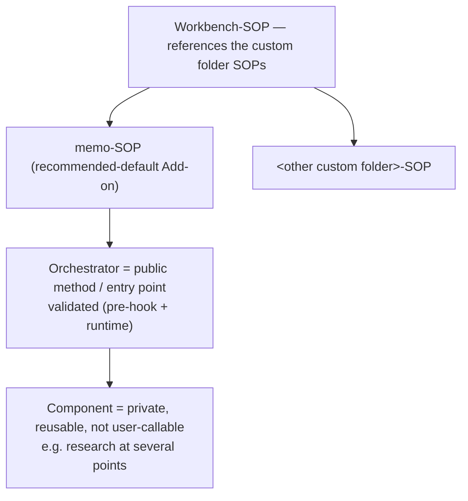
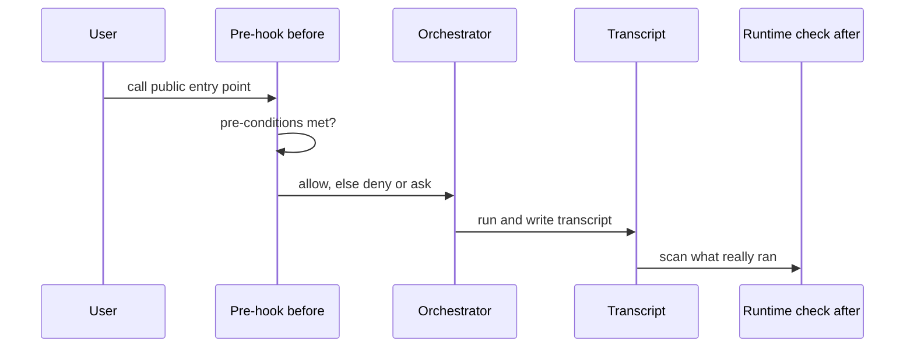

# 24. Skills in the Workbench Scope

| | |
|---|---|
| Status | Draft |
| Depends on | [02-sop-entrypoint.md](./02-sop-entrypoint.md), [21-environment-scripts.md](./21-environment-scripts.md) |
| Related | [31-browser-automation.md](./31-browser-automation.md), [The SOP common denominator](/session/common-denominator/) |

The skills that operate at the workbench level are organized around the **common SOP standard**: a workbench skill serves the Setup, Health, and Update of the workbench scope, plus the scope-specific extras. This chapter records that coupling and where the existing skills fall.

---

## Coupled to the SOP Standard

A workbench skill is an instance of the common SOP denominator ([the SOP common denominator](/session/common-denominator/)) applied to the workbench scope. Its responsibilities map onto the four parts:

| Part | At the workbench scope |
|------|------------------------|
| **Setup** | Bring a project or the workbench into its expected, structured state. |
| **Health** | Verify the workbench setup — do the projects and repositories satisfy the structural checks (see [21-environment-scripts.md](./21-environment-scripts.md)). |
| **Update** | Roll central improvements out into the projects that consume them. |
| **Extras** | Scope-specific capabilities — notably the wiki and the project conventions. |

Organizing workbench skills this way means a reader who knows the SOP standard already knows the shape of the workbench skill set: it is Setup/Health/Update plus the workbench's own extras, not an ad-hoc collection.

The same four-part frame generalizes beyond workbench skills to **every custom folder**: each custom folder's SOP is Setup/Health/Update plus its own tool-specific Extras, scaled to the custom folder's weight ([26-addons.md](./26-addons.md)).

---

## Where the Existing Capabilities Fall

| Capability | Placement |
|------------|-----------|
| Project audit (structure/health) | A **workbench skill** — it realizes the **Health** part (the structural checks of [21-environment-scripts.md](./21-environment-scripts.md)). |
| Documentation scraping | A **borderline** case — closer to user/memo work than to workbench Setup/Health/Update; not a core workbench skill. |
| Phase execution | **Not** a workbench skill — it belongs to the memo-SOP (the core specification's lifecycle), not to the workbench scope. |
| Browser automation | Already covered by [31-browser-automation.md](./31-browser-automation.md) as a project-level method. |

The memo-toolkit capabilities are loaded **dynamically** (progressive disclosure): a skill is brought into context when it is relevant rather than all at once, so the workbench scope stays small at rest and expands only to the task at hand.

---

## Orchestrators and Components

Workbench and custom folder skills split into two roles, by analogy with a class that has public and private methods:

| Role | Analogy | Visibility |
|------|---------|------------|
| **Orchestrator** | a class's **public method** | A user-facing entry point that defines a flow and is invoked from outside. |
| **Component** | a class's **private method** | A reusable building block called *by* orchestrators, not directly by the user. |

A **component** is a part used in several places rather than a standalone entry point — research is the clearest example, reused at multiple points in the memo lifecycle. Components exist today only implicitly; naming the role makes the structure explicit. A skill declares its role in frontmatter:

```yaml
role: orchestrator   # a user-facing entry point
# or
role: component      # a reusable building block, not in the user-callable catalog
```

A skill marked `role: component` is **taken out of the user-callable catalog**: it is private by default, the same posture as a class method that is private unless deliberately exposed. The default is private; an orchestrator is the deliberate exception that is made public.

The two roles sit beneath the custom folder SOPs the workbench-SOP points at ([02-sop-entrypoint.md](./02-sop-entrypoint.md)): each custom folder's orchestrators are its public entry points, and components are the reusable building blocks they call.



---

## The Public-Method Validation Boundary

Why the orchestrator/component split matters is a **systems** argument, stated by analogy with a class:

> A class is a system. Input — and therefore **contamination** — enters through its **public methods**. So the public methods must be **validated**. That is how you build an engine with no internal problems.

The consequences are concrete:

- Validation belongs at the **public entry points** (the orchestrators), because that is the one surface through which outside input enters. Components, being internal, are not called from outside and do not carry the same boundary check.
- The check is on **content, not only types** — not just "is this the right shape?" but "**does this make sense?**". Type-checking the input is necessary and not sufficient.
- **The stricter the public methods, the calmer the interior.** Rigor at the boundary is what lets the inside of the system relax; a lax boundary pushes defensive checks into every internal step.

This is the same public-entry boundary the two checkability mechanisms act on — a **before** pre-hook and an **after** runtime measurement. That before/after split is specified once in [25-validation-overview.md](./25-validation-overview.md); this chapter does not restate the rule, it only places the orchestrator at the boundary. The orchestrators are where the workbench's essential validation layer lives. Enforcing the `role` split with a pre-hook is a later step; the convention is fixed here first — **spec before mechanism**.

One call through the boundary is an ordered exchange, so a sequence diagram traces it best — the pre-hook gates *before* the orchestrator runs, and the runtime check measures *after*, from the transcript the run left behind:



---

## Typed Skill Contracts

Each skill **MUST** declare a **machine-readable typed contract** — typed **inputs** and typed **outputs**, not only the prose `## Skill-Inputs` table or the YAML frontmatter. The prose table documents a skill for a reader; the typed contract states the same surface in a form a machine can check and generate from.

A worked example is a skill like `memo-init`, which consumes a structured transcript. Its input is a `TranscriptPrompt` type — named, typed fields rather than free text:

```yaml
# TranscriptPrompt — the typed input a skill such as memo-init consumes
TranscriptPrompt:
    initiator:   enum[user, llm]   # who started the memo
    title:       string            # one-line subject of the transcript
    topics:      string[]          # the extracted topics, one entry each
    openQuestions: string[]        # questions to resolve before implementation
    sources:     string[]          # linked files / URLs the transcript references
```

The typed contract is the **type half** of the [Public-Method Validation Boundary](#the-public-method-validation-boundary) above. That boundary states that "type-checking the input is necessary and not sufficient": the typed contract makes the boundary **machine-checkable** — a call can be checked against the declared shape automatically — while the **content** check ("does this make sense?") still sits on top. Types are the floor, not the ceiling.

The typed contract **lives in the shared SOP-JSON layer** — alongside the dependency table and the registry ([20-cli.md](./20-cli.md), [23-hooks-contract.md](./23-hooks-contract.md)). One machine-readable layer then carries all three of: **discovery** (what skills and custom folders exist), **preconditions** (what must run first), **and skill I/O types** (the typed contract). They are not three separate stores.

The same typed contract has a **dual use**:

- As a **validation test** — does an actual call's input/output match the declared shape? This is the machine-checkable floor of the boundary above.
- As a **generation template** — the declared shape is a skeleton for building or scaffolding the skill, so the contract that validates a skill is also the contract that seeds it.

This chapter fixes the typed contract **spec-side now**; the implementation is **staggered** and is **not** claimed to be built — consistent with the chapter's **spec before mechanism** posture.

---

## Skill Payload — Where It Lives, How It Is Called, Who Owns It

A skill is not always a single file. Beside `SKILL.md` a skill may carry **payload**: an executable check, reference prose a reader pulls in only when the task needs it, a template. Payload is what makes a rule repeatable — a check that runs can report red over an empty comparison set, and a prose instruction cannot. The gain is **repeatability**, not speed.

Three questions decide whether payload is placed well: **where it lives**, **how it is called**, and **who owns it**. This section answers them in that order, and then states the one cut that settles all three.

### The Corpus Is Smaller Than It Looks

Every figure below was counted over a single comparison set — the **tracked** `SKILL.md` files of this workbench's skill corpus, `skills/**/SKILL.md` of the command-line package, measured on 2026-09-27 over the integrated state of the corpus. The basis is *tracked* files rather than a directory listing on purpose: an untracked editor or filesystem artefact beside a `SKILL.md` would otherwise promote a single-file skill into a payload-carrying one, and one such artefact was measured doing exactly that.

| Size | Count |
|------|-------|
| `SKILL.md` files — the comparison set | 124 |
| skills that are a single `SKILL.md`, with no further file | 53 |
| skills carrying any further file | 71 |
| …whose further files are **only** `evals/` | 53 |
| **skills carrying payload of their own** | **18** |
| …holding at least one non-test `.mjs` | 11 (28 files, 17 of them in three skills) |
| …with a `references/` folder | 6 |
| …with a `templates/` folder | 2 |

An earlier reading of the same comparison set is on record and is kept as a reading rather than corrected away: 120 / 49 / 71 / 54 / **17**, with 10 skills holding 26 non-test `.mjs`, measured on 2026-09-15. Four skills have been added since — the four role skills of the role vocabulary, each a single `SKILL.md`, which is the whole of the 120 → 124 and 49 → 53 growth — and one skill that until then carried nothing but eval fixtures gained a check of its own, which is the whole of the 54 → 53 and 17 → 18 move. The shape of the argument is unchanged by either; the figures carry the day they were taken because that is the only way a later reader can tell the two readings apart.

**`evals/` is not the skill's.** It holds fixtures that the central eval runner owns and reads; the skill is their subject, not their owner. That single distinction decides how widespread the payload idea really is. Counted as "71 skills with payload", it looks like the norm — but 53 of those 71 carry nothing except eval fixtures, and the honest figure is **18**.

### Where Payload Lives

| Place | What belongs there | Owner |
|-------|--------------------|-------|
| `<skill>/scripts/` | a check or helper that computes over exactly the artifacts this skill touches anyway | the skill, as **caller** |
| `<skill>/references/` | prose the skill pulls in on demand — the progressive-disclosure tier below `SKILL.md` | the skill |
| `<skill>/templates/`, `<skill>/data/`, `<skill>/examples/` | fixed inputs the skill's own steps read | the skill |
| `<skill>/evals/` | fixtures for the central eval runner | **the eval runner, not the skill** |
| `skills/_shared/` | text that several skills reference, each passage with exactly one definitions home | shared — referenced from skill bodies, read by the repository's guards |
| `skills/_lint/` | two corpus-wide checks | **nobody today** — see the disposition below |
| the repository's own `scripts/` folder (here `repos/core/scripts/`) | a check that computes over a **corpus** | the repository, through its `npm run lint` chain |
| a CLI leaf | anything that **writes** | the CLI |

### How Payload Is Called

Payload is reached through the step that owns it, never by a reader guessing at a path:

- **The call names the path in full, relative to the repository root.** The same line then reads the same from a checkout, from a worktree, and in a reader's head.
- **The call sits in the step that is responsible for it**, not in an appendix. A script named nowhere is a script nobody runs.
- **The caller relation is machine-checked.** A declared relation between a step and its script carries a minimum number of callers, so a script that loses its caller turns the lint chain red instead of quietly becoming an orphan.

### Who Owns Payload — the Cut Is the Write Right

> **Does it write into the database? Then it is a CLI leaf. Does it compute over a corpus? Then it belongs in the repository's `scripts/` folder, on `npm run lint`. Does it compute over exactly the artifacts a skill touches anyway? Then it MAY live with the skill — as a caller of existing logic, never as a second carrier of the rule.**

The cut is the **write right, not the file form**. A *writing* skill script would open a second write path beside the CLI, a step back behind the single write edge the CLI exists to be. A *computing* script that returns a verdict together with its comparison set collides with nothing. That is why the same file form is admissible in the one case and excluded in the other.

Two consequences are normative here:

- A skill script **MUST NOT** write into a store the CLI owns.
- A skill script **MUST** call existing logic rather than restate a rule that already has a home. A rule written out twice has two truths from the moment one copy is edited.

### The Folder Names an Owner, It Does Not Encapsulate

Of the 28 non-test `.mjs` files placed inside skill folders, **24** import upward out of the skill and into the repository — `../../../../lib/…` and `../../../../scripts/lib/…`, with the more deeply nested ones climbing five levels rather than four. The depth follows the nesting; it does not mark a package boundary, because there is none.

Payload of this kind is therefore a **repository tool with skill-shaped placement**, not a transportable add-on. Copying a skill folder elsewhere carries the caller and leaves the callee behind. Reading a `scripts/` folder beside a `SKILL.md` as a self-contained bundle builds on an encapsulation that does not exist: the folder states **who is responsible**, and that is all it states.

### `skills/_lint/` — the Third Placement, and Its Disposition

Beside the skill-owned placement and the eval-runner placement there is a third one, and until now it was written down nowhere. `skills/_lint/` sits next to the skill categories rather than inside one. Measured over that folder:

| Property | Finding |
|----------|---------|
| files | 2, both `.mjs` |
| what they read | the **whole** skill corpus — each walks `skills/` and collects every `SKILL.md` |
| what they write | nothing but an exit code |
| callers | **none** in the repository — no lint-chain entry, no test, no skill step |
| owning skill | none |
| current verdict when run by hand | both pass, each over all 124 `SKILL.md` — measured 2026-09-27, `status: true` and no problem on either, over the same comparison set as the corpus table above |

Both are corpus-computing checks without a write right, so the rule above already names their home: the repository's `scripts/` folder, wired into `npm run lint`. **`skills/_lint/` is therefore to be dissolved**, and the two files leave by different doors:

- The **visibility** check states a rule that a chain member already enforces, and enforces it more weakly: the chain member requires that exactly the canonical entry points are public and every other skill is private, while the orphan only forbids a non-canonical skill from being public. It carries the same list of entry points as a second copy, which is precisely the *second carrier of the rule* the cut above forbids. It is **retired**, not moved.
- The **single-source** check over the server-operation block has no equivalent on the chain — no chain member names that rule at all. It **moves** into the repository's `scripts/` folder and is wired in, so that the rule it carries gets the one home it has been missing.

Until both moves happen the folder is at least stated here, instead of remaining a placement model that no page accounts for.

`skills/_shared/` is **not** in the same position and is **not** proposed for dissolution: its files are referenced from skill bodies and read by the repository's own guards, so it has a working owner even though no single skill holds it.

**Spec before mechanism**: this section fixes the placement, the call form, and the ownership. Relocating existing payload and enforcing the caller relation are separate steps, and this chapter claims neither is finished.

---


<!-- IMPLEMENTED-BY — rendered backlink lives in the dist (generated/bridge/<family>/<stem>.backlink.md); source stays authored-only (F2 Dist-Split) -->
## Related

- [26-addons.md](./26-addons.md) — the custom folder model the Setup/Health/Update/Extras frame generalizes to.
- [23-hooks-contract.md](./23-hooks-contract.md) — the entry-point pre-condition that guards a public method *before* the call.
- [20-cli.md](./20-cli.md) — the runtime call-validation that measures the boundary *after* the call.
- [25-validation-overview.md](./25-validation-overview.md) — the single source of the before/after validation split, and the validation-code index.
- [The SOP common denominator](/session/common-denominator/) — the Setup/Health/Update standard these skills realize.
- [21-environment-scripts.md](./21-environment-scripts.md) — the health checks the audit skill performs.
- [31-browser-automation.md](./31-browser-automation.md) — the project-level browser-automation method.
